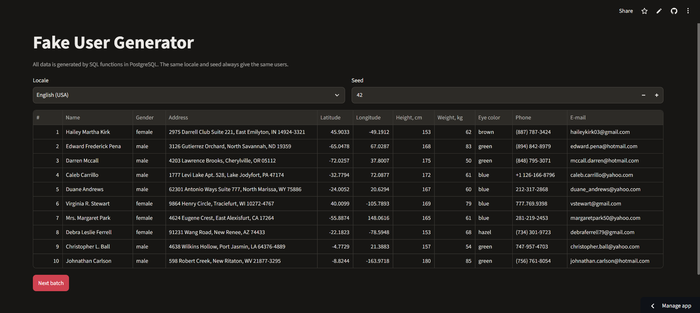
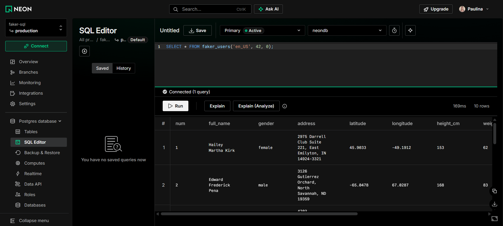

# SQL Fake User Generator

Generates realistic fake people (names, addresses, locations, phone numbers, e-mails, height and weight) **entirely inside a PostgreSQL database**. The same settings always give the same people, so test data can be recreated at any time.

[🚀 Live app](https://sql-faker.streamlit.app) · [🎥 Video](https://youtu.be/KFyd7sDnOS0) · [📘 Technical details](docs/technical.md)

## What it does

- **Two countries:** USA and Germany, each with its own names, address and phone formats.
- **Repeatable:** the same seed always gives the same people.
- **Realistic bodies:** height depends on gender, weight matches height.
- **Locations** spread evenly over the globe.
- **Fast:** about 1,900 people per second on a free cloud database.
- **Easy to extend:** a new country is just new rows in a table, no code changes.

## Tech

PostgreSQL (Neon), SQL functions, Python, Streamlit, psycopg

## Run locally

    pip install -r requirements.txt
    python setup_db.py "<connection string>"
    streamlit run app.py

The app needs `DATABASE_URL` in `.streamlit/secrets.toml`.